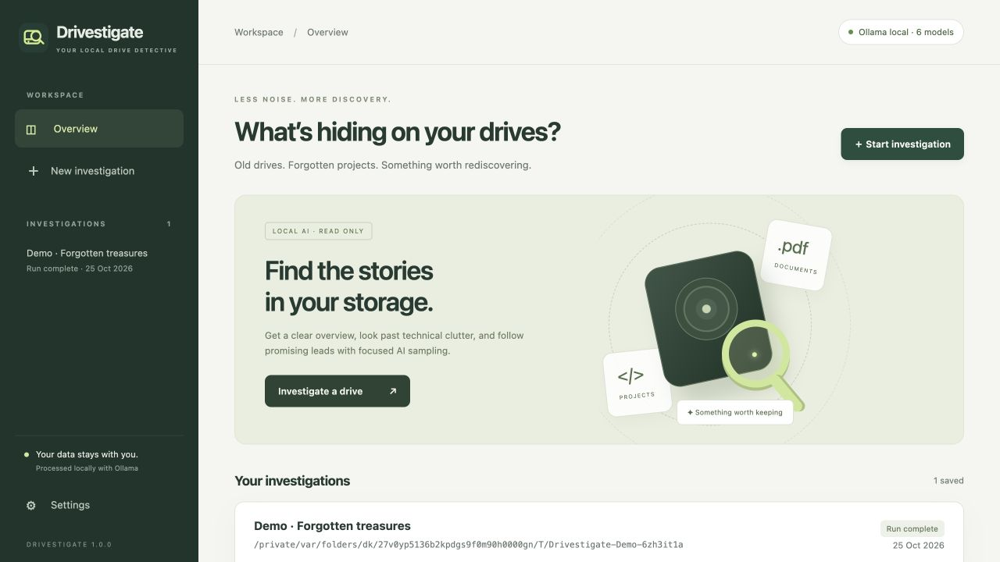
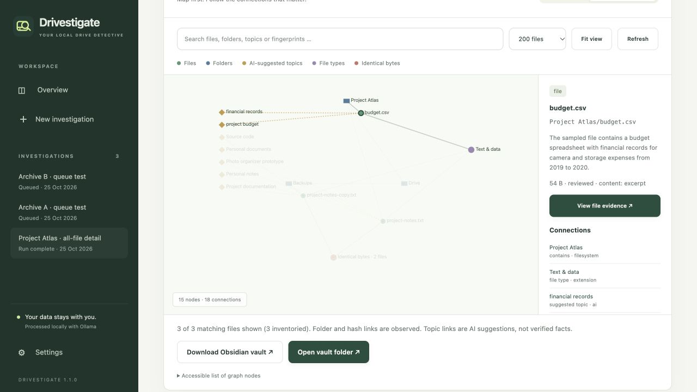

# Drivestigate

**Investigate your drives. Rediscover what matters.**

A local macOS application for exploring old hard drives and USB sticks with Ollama.
It builds a resumable metadata catalog, queues investigations, groups technical clutter,
and produces evidence-based reports with Finder links. A live folder map shows progress.
All-file detail mode adds full-byte fingerprints, per-file assessments, a visual knowledge
graph and an exportable Obsidian vault.



## Start on macOS

Requirements: Python 3.11 or later, Ollama running locally, and an installed local
text/completion model. A vision-capable model is needed only for optional image sampling.

```sh
git clone https://github.com/qubit85/Drivestigate.git
cd Drivestigate
bash scripts/setup.sh
./Start\ Drivestigate.command
```

You can also double-click **Start Drivestigate.command** in Finder. The first launch
installs PDF/image support into a project-local virtual environment; this installation
requires an internet connection. Runtime processing does not require internet access.
Open [127.0.0.1:8741](http://127.0.0.1:8741) if the browser does not open automatically.
Keep the terminal running; Ctrl+C stops the application. Your progress is preserved.

The default model name is `qwen35-9b-alltag-64k:latest`; select your own installed model
in **Settings**. The model name is a configuration default, not a required download.
The Ollama MLX runner is supported even when native structured output is unavailable:
Drivestigate validates the model's JSON and all referenced file IDs itself.

### Self-contained macOS application

The build script creates `dist/Drivestigate.app` with Python, PDF/image readers, and the
web interface bundled. It only needs your local Ollama service at runtime:

```sh
.venv/bin/python -m pip install -c constraints.txt pyinstaller
bash scripts/build_macos.sh
```

Quit the desktop app before rebuilding; the build script refuses to replace a running bundle.
The desktop bundle is built for the architecture of the build Mac. Local builds are
ad-hoc signed; public distribution still requires your Apple Developer identity and
notarization. Closing the browser does not stop the background desktop app; use Quit
from its Dock icon. The source launcher remains useful for development and terminal logs.

## Workflow

1. Open **Settings**. Select a local model and test the connection. Edit the system
   prompt, add search priorities, save reusable profiles, and choose sampling budgets.
2. Start **New investigation**. Choose a mounted drive or folder, select **Sampled files**
   or **All files + Obsidian vault**, and add it to the queue. The synthetic demo is optional.
3. Inventory enumerates every accessible directory entry and collects metadata. Excluded
   paths, symlinks, other mounted filesystems, permission errors and unreadable filenames
   are logged. Files are not opened for their contents during inventory.
4. Relevant folders receive visible metadata findings before AI analysis starts. The
   investigator prioritizes filenames, types and your search focus, then samples different
   extensions, ages, sizes and a deterministic random slice. Qwen can request a second round.
5. Read the report. Folder names open Finder; sample filenames reveal the file in Finder.
   **Copy path** also works while a drive is disconnected. **Investigate further**
   requests additional samples from one folder. **Resume** investigates remaining folders.
6. Export HTML, CSV or JSON. HTML links return to that finding in the running local app,
   where Finder actions are available. Standalone exported HTML does not directly launch Finder.

The persistent queue runs one investigation at a time. On **Overview**, drag queued jobs or
use the up/down buttons to reorder them. **Hold queue** prevents the next job from starting
while allowing the active job to finish. Remove a queued job to preserve it as paused.
Disconnected jobs wait without blocking connected drives and are retried automatically.
After restarting, interrupted active jobs are paused; queued jobs retain their order.

The report shows phase progress, completed/total units, throughput and elapsed time.
A rough ETA range appears after two completed units in the current processing phase.
It uses recent unit durations and excludes later phases. Inventory cannot estimate a
total until discovery finishes; large files and variable model latency can change the ETA.
The live folder tree distinguishes discovery, metadata inventory, sampling, completed
processing and read issues. The size map shows up to 24 largest immediate entries;
expand folders and drill down to inspect their files. Folder status describes own files.

Pause/stop take effect at the next checkpoint; an in-flight
model request can take up to the configured request timeout. Interrupted scans can be resumed. Completed scans with unreviewed folders can also be continued.
Prompts, filters, model selection and budgets are snapshotted per scan. To use different
settings on existing material, create a new scan. Budgets renew on each explicit resume
or deepen action. Metadata inventory is not limited by the AI time budget.

## One comprehensive report per investigation

The report begins with a consolidated document: a content narrative, inventory totals,
file-type and top-level storage charts, review coverage, a last-modified-year timeline,
up to ten promising evidence paths and recommended next steps. Low-priority findings
stay outside the short reading list. All inventory bytes remain accounted for, including
technical material and folders grouped under “Other”. Individual finding cards are
available in the expandable **Individual findings & evidence** section.

A report is saved automatically after each completed investigation run, including runs
that finish at their sampling budget. It states the remaining coverage gaps. A single
additional local Qwen synthesis request (bounded to 60 seconds) summarizes saved
assessments and aggregate metadata; source files are not read again. Overview budgets
apply to investigation requests; report synthesis has this separate bounded request.
If synthesis fails, a readable catalog summary and all charts remain available.
Structural detail mode with AI disabled does not call the model for its report.

**Generate report / Regenerate report** also works for older or paused investigations,
including disconnected sources. This task uses the persistent queue, preserves the
original investigation phase/status and does not resume file scanning. Opening an older
completed investigation generates its missing report automatically. Resuming a scan
marks its previous report as stale until a fresh version is ready.

**Open / save full report** opens a portable HTML document with its styles included.
Save it from the browser or use Print / Save as PDF. Evidence links return to the local
app; paths in the in-app report open Finder when the source is connected. Exports contain
private paths and model assessments and should be handled like the source material.

Scan modes are now labeled **Sampled files** and **All files + Obsidian vault** in
**New investigation**. Each existing investigation also displays its current mode and
provides a button to prepare a new investigation in the other mode. Changing modes
starts a separate catalog snapshot rather than changing how saved findings were obtained.

Every folder now has a plain-text description. Hover or keyboard-focus its name in the
folder tree, size map or entry list to see a tooltip; Escape dismisses it. Select **ⓘ**
for the full text, **Copy summary** and Finder access. Opening a folder also shows its
summary above the size map. The selected-folder preview is expandable and links to the
full summary, so long descriptions do not overwhelm the map.

Descriptions reuse saved sampled or per-file assessments when available. Unreviewed
folders receive a clearly labeled filename/metadata summary with file types and example
paths. Parent folders can show selected reviewed descendants without claiming the whole
subtree was reviewed. Incomplete inventories, skipped paths and read issues remain
explicit. Reading a folder summary requires no new source-file read or model request,
and works with a disconnected source. Summaries are fetched on demand and cached until
the investigation changes.

The folder map scales labels to available tile space. Entries too small to draw remain
accessible in the compact list below it, including on narrow screens.

## All-file detail and the knowledge graph



**All files + Obsidian vault** attempts every inventoried regular file, including
technical files. Each accessible unchanged file is read completely for a SHA-256
fingerprint, then receives a bounded supported content extraction and, by default, one
local-model assessment with suggested topics. Overview sampling, time and read budgets
do not truncate detail mode. Pause or stop it when needed. Failed AI requests pause for
retry after three attempts; completed file work is retained. Files that change or cannot
be read remain visible with errors. Exclusions and skipped filesystem entries still apply.

A complete fingerprint means every byte was read for hashing. **It does not mean the AI
understood the whole file.** The supported extraction limits below still apply. Unsupported
binaries, large PDFs, encrypted documents and other unavailable content receive metadata
assessments. Separate counters show processed files, full fingerprints, AI assessments,
readable content samples and errors. Disable per-file AI in Settings for a structural
all-file pass with fingerprints and an Obsidian vault, without semantic topic links.

Select **Knowledge graph** in a report to explore files, folders, extension-derived types,
AI-suggested topics and exact duplicate groups. Solid folder/hash links are observed;
dashed topic links are model suggestions. Click nodes for connections and evidence, drag
to rearrange, pan and zoom, or use the keyboard and accessible node list. Search narrows
the graph; the display is capped at 100–400 files for responsiveness. The vault includes
all inventoried files, independently of that display cap. A graph is useful for connecting
related material across folders; the folder map remains the clearest completeness view.

After detail mode completes, **Download Obsidian vault** exports the linked notes as ZIP.
**Open vault folder** opens the generated folder in Finder; open that folder as a vault
in Obsidian and select Graph view. It contains one note per file and folder, topic/type
notes, duplicate groups and coverage/issue notes using standard wikilinks. File and folder
notes have human-readable names with stable IDs so their Obsidian graph labels remain useful. File notes link
back to their evidence in the running Drivestigate instance. See Obsidian's
[internal links](https://help.obsidian.md/links) and [Graph view](https://help.obsidian.md/plugins/graph).

Vaults are stored separately under the catalog's `vaults/` directory. Each build creates
a new folder so user edits to older exports survive. Original files are never copied.
Source excerpts are omitted by default; opt in under Settings if wanted. File names,
paths, summaries, topics and hashes are still potentially private. Nothing is imported
into an existing personal Obsidian vault automatically. HTML, CSV and JSON detail exports
also include the per-file coverage ledger. **Rebuild Obsidian vault** regenerates notes
from the saved snapshot; create a new investigation to inspect changed source material.

## What is actually inspected?

| Type | Sampling behavior |
| --- | --- |
| Text, code, CSV, JSON, email | Up to 16 KB read; at most 6,000 characters retained per sample |
| PDF | Files up to 2 MiB, first three pages; requires pypdf; scanned/encrypted PDFs remain metadata |
| DOCX, XLSX, PPTX | Files up to 2 MiB; selected XML text only, no macros or external links executed |
| ZIP | Files up to 2 MiB; up to 80 entry names, never extract archive members to disk |
| Images | Files up to 2 MiB; dimensions by default, optional 512 px thumbnail sent to local vision model |
| Video, audio, legacy Office, RAR/7z, disk images, databases | Metadata only; reported as uninspected content |

Only excerpts are sent to the model, with additional per-request truncation to keep the
context manageable. Technical classification uses conservative path/extension rules;
potential user documents inside application folders remain visible. It is still a heuristic.
No OCR, recursive archive extraction, malware scan, forensic recovery, duplicate removal, or
proof that all important files have been found is implied. Empty folders have inventory
entries but no content finding. A grouped technical file is **not** a deletion recommendation.

## Local data and safety

- The application listens only on `127.0.0.1`. Sessions use an HttpOnly SameSite cookie,
  a per-run CSRF token, Host/Origin checks, CSP and no third-party browser assets.
- Only a loopback Ollama URL is accepted. Cloud model entries are filtered and remote
  model metadata is rejected. No source files are uploaded by Drivestigate. For defense
  in depth, Ollama supports `OLLAMA_NO_CLOUD=1` on the **Ollama service**, followed by a
  service restart; see the [official Ollama FAQ](https://docs.ollama.com/faq#how-do-i-disable-ollamas-cloud-features).
- Source files are opened read-only. Symlinks and special files are not followed; Finder
  accepts catalog IDs rather than arbitrary user-supplied paths. Extraction runs in a
  separate process with time and memory/CPU limits where supported. This is a resource
  boundary, not an OS sandbox for parser vulnerabilities. Keep parser dependencies updated.
- No source scripts, executables, macros or file-embedded commands are executed. Model
  output is validated and rendered as text. The model cannot run tools or mutate files.
- The OS can update access times or its own volume metadata when reading a mounted drive.
  For a forensic write guarantee, use a read-only mount or hardware write blocker.
- Catalogs contain filenames, model assessments, prompts and short sample excerpts. They
  are private local data, not encrypted at rest by this application. Protect them as you
  would protect the scanned files. Exports can contain the same sensitive information.
- The original volume is recognized using root-directory identity and, on macOS, its volume
  UUID if the device number changes. Keep its mount path stable. To scan a relocated or
  modified source afresh, create a new scan. Catalogs are snapshots, not live synchronization.

Default catalog location on macOS: `~/Library/Application Support/Drivestigate/`.
Use `--data-dir /path/outside/the/source` or `DRIVESTIGATE_DATA_DIR` to change it.
The source cannot contain the catalog directory. Back up the catalog only while the
application is stopped (SQLite uses WAL). Nothing under `.data/` is committed to Git.
Synthetic demo folders are created in the system temporary directory and can be removed
when no longer needed; saved reports remain in the catalog.

```sh
.venv/bin/python -m drivestigate.server --no-browser --port 8741 --data-dir .data
```

## Troubleshooting

- **Ollama unavailable:** start Ollama, verify its address, then refresh the model list.
- **Model missing:** select an installed local completion model; Drivestigate does not pull models.
- **Model errors:** check the report's events. After three consecutive failed calls, the scan
  pauses. Decrease sampling/prompt size or use a more capable model in a new scan.
- **Permission denied:** macOS may require Files and Folders access for the terminal/Python
  host. Grant only the access needed for your chosen drive; the app does not change permissions.
- **Disconnected:** reconnect the same volume at the same mount path, then resume.
- **Port already used:** stop the existing instance or choose another `--port`.
- **No content samples:** inspect each sample's status; large/unsupported/encrypted files
  may intentionally receive only a metadata assessment.

## Development

The core server, inventory and catalog use Python's standard library. The browser UI is
plain JavaScript/CSS; no frontend build or external CDN is needed. Optional readers are
installed by the normal setup script. macOS Finder integration is the supported desktop
target; core scanning also runs on Linux with manual paths and copied links.

```sh
.venv/bin/python -m pip install -c constraints.txt '.[documents,dev]'
.venv/bin/ruff check .
.venv/bin/ruff format --check .
.venv/bin/python -m pytest -q
node --check drivestigate/static/app.js
node --check drivestigate/static/visuals.js
```

Tests use synthetic data and an injected model client. They cover persistence, pause/resume,
budgets, unchanged source content/mtime, unsafe paths and symlinks, disconnected drives,
model-output validation, exports, CSRF and session boundaries. Queue recovery, reordering,
all-file coverage, fingerprints, graph provenance and Obsidian links are also covered. GitHub Actions defines
Linux/macOS checks for Python 3.11, 3.12 and 3.14. Live-model and UI acceptance checks are
documented in [docs/VALIDATION.md](docs/VALIDATION.md).
